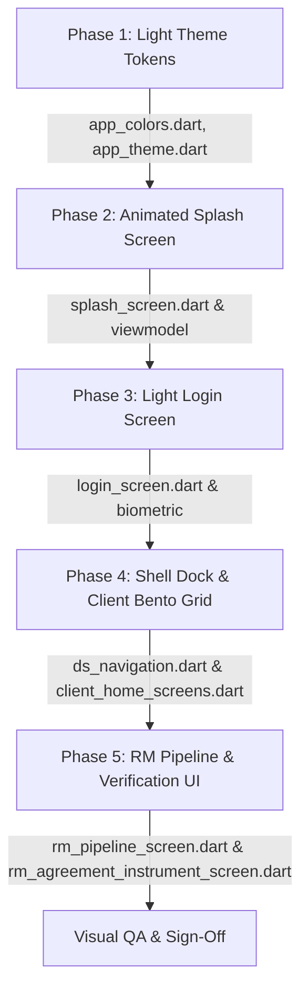

# HomeGenny Mobile UI Redesign Specification: Trending Light Theme (Orange & Blue)

> **Document Type**: UI/UX & Technical Design Architecture Document  
> **App Version**: 1.0.0+1  
> **Theme Concept**: Light Luxe & Cyber-Clean Minimal (No Dark Mode)  
> **Primary Accents**: Flame Orange (`#F97316`) & Electric Cobalt Blue (`#2563EB`)  
> **Platform**: Flutter (Android, iOS)

---

## Table of Contents
1. [Executive Summary & Visual Philosophy](#1-executive-summary--visual-philosophy)
2. [Color Palette & Token System](#2-color-palette--token-system)
3. [Typography & Text Hierarchy](#3-typography--text-hierarchy)
4. [Animated Splash Screen Choreography](#4-animated-splash-screen-choreography)
5. [Login Screen Transformation](#5-login-screen-transformation)
6. [App Shell & Floating Navigation Dock](#6-app-shell--floating-navigation-dock)
7. [Client Home Bento Grid Architecture](#7-client-home-bento-grid-architecture)
8. [Relationship Manager (RM) Pipeline & Verification Screens](#8-relationship-manager-rm-pipeline--verification-screens)
9. [Component & Widget Design Standards](#9-component--widget-design-standards)
10. [Technical Implementation Roadmap & File Matrix](#10-technical-implementation-roadmap--file-matrix)

---

## 1. Executive Summary & Visual Philosophy

```
  ┌────────────────────────────────────────────────────────────────────────┐
  │                         COLOR HARMONY MATRIX                           │
  │                                                                        │
  │   [#F8FAFC]          [#FFFFFF]          [#F97316]          [#2563EB]   │
  │   Canvas Alabaster   Crisp White Card   Flame Orange       Electric    │
  │   Base Background    Bento Surface      Action & Urgent    Cobalt Blue │
  └────────────────────────────────────────────────────────────────────────┘
```

HomeGenny’s light aesthetic provides a **crisp, elevated, high-contrast light experience**:
- **Airy Alabaster Base (`#F8FAFC`)**: Soft on the eyes during prolonged daylight use, providing optimal contrast against pure white cards.
- **Layered Pure White Surfaces (`#FFFFFF`)**: Crisp elevated cards with 1px slate borders (`#E2E8F0`) and subtle ambient shadows (`rgba(0,0,0,0.04)` to `0.06`).
- **Tactile Squircle Elements**: 12px–20px rounded squircle containers with light tinted container fills (`#EFF6FF` for blue, `#FFF7ED` for orange).
- **Dual-Accent Semantic Division**:
  - **Flame Orange (`#F97316` / `#EA580C`)**: High-energy primary actions, urgent payment badges, active action prompts, live alert notifications, and main Sign-In CTA.
  - **Electric Cobalt Blue (`#2563EB` / `#1D4ED8`)**: Institutional credibility, brand wordmark, verified identity chips, attendance progress metrics, CareShield security seals, and navigation anchors.

---

## 2. Color Palette & Token System

### 2.1 Core Palette Tokens

| Token Name | Hex Code | Role in Light Theme |
| :--- | :--- | :--- |
| `AppColors.lightBackground` | `#F8FAFC` | Alabaster root scaffold canvas |
| `AppColors.lightSurface` | `#FFFFFF` | Bento cards, bottom sheets, list cards |
| `AppColors.lightSurfaceVariant`| `#F1F5F9` | Input field background, subtle chip backings |
| `AppColors.lightBorder` | `#E2E8F0` | Default 1px card perimeter & divider |
| `AppColors.borderFocus` | `#CBD5E1` | Active input or hovered card border |
| `AppColors.primary` (Orange) | `#F97316` | Primary action buttons, urgent alerts |
| `AppColors.primaryLight` | `#FB923C` | Hover states, button gradient start |
| `AppColors.primaryDark` | `#EA580C` | Button gradient end, active tap state |
| `AppColors.primaryContainer` | `#FFF7ED` | Orange badge pill backing (10-14% alpha) |
| `AppColors.secondary` (Cobalt) | `#2563EB` | Wordmark, verified badges, attendance arc |
| `AppColors.secondaryLight` | `#3B82F6` | Glow rings, active category pills |
| `AppColors.secondaryDark` | `#1D4ED8` | Secondary action pressed states |
| `AppColors.secondaryContainer`| `#EFF6FF` | Cobalt badge pill backing (10-14% alpha) |
| `AppColors.lightTextPrimary` | `#0F172A` | Primary headlines, amounts, bold labels |
| `AppColors.lightTextSecondary`| `#64748B` | Secondary descriptions, timestamps |
| `AppColors.lightTextHint` | `#94A3B8` | Input placeholders, inactive labels |

### 2.2 Ambient Shadows & Gradients
- **Primary CTA Orange Glow**:
  ```dart
  BoxShadow(
    color: const Color(0x33F97316),
    blurRadius: 18,
    spreadRadius: 0,
    offset: const Offset(0, 6),
  )
  ```
- **Cobalt Trust Glow**:
  ```dart
  BoxShadow(
    color: const Color(0x2E2563EB),
    blurRadius: 16,
    spreadRadius: 0,
    offset: const Offset(0, 6),
  )
  ```
- **Light Bento Card Shadow**:
  ```dart
  BoxShadow(
    color: const Color(0x0A000000),
    blurRadius: 16,
    spreadRadius: 0,
    offset: const Offset(0, 4),
  )
  ```

---

## 3. Typography & Text Hierarchy

We combine **Libre Caslon Text** (for elegant editorial brand prestige) with **Inter** (for crisp functional UI readability):

1. **Brand Titles & Display**:
   - Font: `GoogleFonts.libreCaslonText`
   - Weight: `FontWeight.w700` | Size: 32px – 38px
   - Color: `AppColors.lightTextPrimary` (`#0F172A`) or `AppColors.secondary` (`#2563EB`)
2. **Section Headers & Bento Titles**:
   - Font: `GoogleFonts.inter`
   - Weight: `FontWeight.w600` | Size: 18px – 20px
   - Color: `AppColors.lightTextPrimary` (`#0F172A`)
3. **Eyebrows & Micro-Category Labels**:
   - Font: `GoogleFonts.inter`
   - Weight: `FontWeight.w700` | Size: 10px – 11px
   - Letter Spacing: `1.5px` (All-caps: e.g. `OVERVIEW`, `PENDING INVOICE`)
   - Color: `AppColors.primary` (`#F97316`) or `AppColors.secondary` (`#2563EB`)
4. **Body Copy & Metadata**:
   - Font: `GoogleFonts.inter`
   - Weight: `FontWeight.w400` | Size: 13px – 14px
   - Color: `AppColors.lightTextSecondary` (`#64748B`)
5. **Financial Figures & Metrics**:
   - Font: `GoogleFonts.inter` or `Space Grotesk`
   - Weight: `FontWeight.w700` | Size: 22px – 26px
   - Color: `AppColors.lightTextPrimary` (`#0F172A`)

---

## 4. Animated Splash Screen Choreography

The Splash screen transitions from a cold boot to an engaging brand arrival, orchestrating animations with `flutter_animate` before opening the **Login Screen**.

```
Timeline (Total 2.4s):
0.0s ─────── 0.6s ─────── 1.2s ─────── 1.8s ─────── 2.2s ─────── 2.4s
 │             │            │            │            │             │
 ├─ [Logo Entrance]         │            │            │             │
 │  Scale (0.6 ➔ 1.0)       │            │            │             │
 │  Elastic bounce          │            │            │             │
 │  Glow Ring Pulse         │            │            │             │
 │                          │            │            │             │
 └──────────────────────────┼─ [Typography Reveal]    │             │
                            │  "HomeGenny" slide up   │             │
                            │  "YOUR HOME, SIMPLIFIED"│             │
                            │  fade + tracking spread │             │
                            │                         │             │
                            └─────────────────────────┼─ [Dual-Tone Loader]
                                                      │  Orange + Blue dots
                                                      │  smooth breathing
                                                      │
                                                      └─ [Exit Fade Out]
                                                         ➔ context.go(AppRoutes.login)
```

### Visual Specifications of Splash Components:
1. **Canvas**: Pure Alabaster (`#F8FAFC`) with subtle ambient radial gradients in Orange (top-left) and Cobalt Blue (bottom-right) at 4% opacity.
2. **Central Hero Badge**:
   - Elevated white card (`112x112px`, radius 28px) with subtle border `Border.all(color: Color(0xFFE2E8F0))`.
   - Dual-color concentric pulse rings: Outer ring in Cobalt Blue (`0x142563EB`), middle ring in Flame Orange (`0x14F97316`).
   - Iconography: `Icons.home_rounded` (56px) in Electric Cobalt Blue with mini `Icons.bolt_rounded` (16px) badge in Flame Orange.
   - Animation: `.animate().scale(duration: 700.ms, curve: Curves.easeOutBack).fadeIn(duration: 500.ms)`.
3. **Wordmark & Subtitle**:
   - `Text('HomeGenny')` in `Libre Caslon Text` (38px, `#0F172A`), animated with `.fadeIn(delay: 300.ms).slideY(begin: 0.3, end: 0, duration: 600.ms)`.
   - `Text('YOUR HOME, SIMPLIFIED')` in `Inter` (11px, `#64748B`, tracking `2.0`), animated with `.fadeIn(delay: 500.ms, duration: 500.ms)`.
4. **Dual-Tone Status Indicator**:
   - Three animated pulsing capsules at the bottom: Left (Orange `#F97316`), Center (Blue `#2563EB`), Right (Orange `#F97316`) that pulse gently.
5. **Auto-Navigation Handler**:
   - After initialization completes and duration has elapsed, executes `context.go(AppRoutes.login)` with a smooth transition.

---

## 5. Login Screen Transformation

```
┌─────────────────────────────────────────────────────────────┐
│                       [ HomeGenny Icon ]                    │
│                                                             │
│                      Sign in to HomeGenny                   │
│             Manage your domestic ecosystem with ease.       │
│                                                             │
│  MOBILE NUMBER                                              │
│  ┌───────────────────────────────────────────────────────┐  │
│  │  📱  9876543210                                       │  │
│  └───────────────────────────────────────────────────────┘  │
│                                                             │
│  PASSWORD                                Forgot password?   │
│  ┌───────────────────────────────────────────────────────┐  │
│  │  🔒  ••••••••                                    👁  │  │
│  └───────────────────────────────────────────────────────┘  │
│                                                             │
│  ┌───────────────────────────────────────────────────────┐  │
│  │      SIGN IN  ➜      (Flame Orange Gradient Glow)      │  │
│  └───────────────────────────────────────────────────────┘  │
│                                                             │
│  ───────────────  OR SIGN IN WITH BIOMETRICS  ──────────────  │
│                                                             │
│  ┌───────────────────────────────────────────────────────┐  │
│  │   [ 🫆 ]  USE BIOMETRIC ACCESS (Electric Blue Border) │  │
│  └───────────────────────────────────────────────────────┘  │
│                                                             │
│              Don't have an account? Sign Up                 │
│                                                             │
│   [Client Demo]         [Staff Demo]           [RM Demo]    │
└─────────────────────────────────────────────────────────────┘
```

### Element Breakdown:
- **Card Input Containers**: White background (`#FFFFFF`), border radius `12px`, subtle border `#E2E8F0`. Focused state switches to `Border.all(color: Color(0xFF2563EB), width: 1.5)`.
- **Primary CTA ("SIGN IN")**:
  - Gradient: `LinearGradient(colors: [Color(0xFFF97316), Color(0xFFEA580C)])`.
  - Border radius: `12px`.
  - Shadow: Orange diffuse glow (`0x33F97316`, blur: 16px).
- **Secondary CTA ("BIOMETRIC LOGIN")**:
  - Pure white background, `1.5px` border in Electric Cobalt Blue (`#2563EB`), cobalt icon and text.
- **Role Demo Switchers**:
  - Three lightweight chips (`Client Demo`, `Staff Demo`, `RM Demo`) with `#F1F5F9` background and `#CBD5E1` border for instant sandbox testing.

---

## 6. App Shell & Floating Navigation Dock

*Reference: [client_shell_screen.dart](file:///c:/Users/dell/Desktop/Flutter/homegennyapp/lib/features/client/presentation/navigation/client_shell_screen.dart) & [ds_navigation.dart](file:///c:/Users/dell/Desktop/Flutter/homegennyapp/lib/design_system/widgets/navigation/ds_navigation.dart)*

```
┌─────────────────────────────────────────────────────────────┐
│  Client Screen Content...                                   │
│                                                             │
│       ┌──────────────────────────────────────────────┐      │
│       │  [ 🏠 ]     [ 👥 ]     [ 💳 ]     [ ⚙ ]     [ 👤 ]   │      │
│       │  Home      Staff       Pay      Settings   Profile  │      │
│       └──────────────────────────────────────────────┘      │
│             ▲                                               │
│     Active Pill: Electric Blue container + white icon       │
└─────────────────────────────────────────────────────────────┘
```

- **Floating Glass Dock**:
  - Margin: 20px horizontal, 16px bottom.
  - Shape: `BorderRadius.circular(28)`.
  - Background: Acrylic frosted glass (`rgba(255, 255, 255, 0.90)` + `ImageFilter.blur(sigmaX: 16, sigmaY: 16)`).
  - Border: 1px `#E2E8F0` with subtle elevation shadow `BoxShadow(color: Color(0x0F000000), blurRadius: 20, offset: Offset(0, 8))`.
- **Item States**:
  - **Inactive Items**: Slate icon (`#64748B`), 10px subtitle.
  - **Active State (Default / Home / Staff)**: Electric Cobalt Blue capsule (`#2563EB`) with white icon, cyan label (`#2563EB`), and blue diffuse glow.
  - **Active State (Pay)**: Flame Orange capsule (`#F97316`) when unpaid invoices exist, with an orange notification pip at top-right.

---

## 7. Client Home Bento Grid Architecture

*Reference: [client_home_screens.dart](file:///c:/Users/dell/Desktop/Flutter/homegennyapp/lib/features/client/presentation/screens/home/client_home_screens.dart)*

```
┌─────────────────────────────────────────────────────────────┐
│  HOMEGENNY (Cobalt Blue)          [ 🔔 Glass ]       [ 👤 ] │
│  OVERVIEW                                                   │
│  Welcome back, Sarah                                        │
│  Your personal domestic care ecosystem                      │
│                                                             │
│  ┌───────────────────────────────────────────────────────┐  │
│  │  [ + ] NEW REQUEST   (Flame Orange CTA Button)        │  │
│  └───────────────────────────────────────────────────────┘  │
│                                                             │
│  ┌───────────────────────────────────────────────────────┐  │
│  │  STAFF SPOTLIGHT CARD                      [✓ VERIFIED]│  │
│  │  [Avatar Ring: Blue]  Anita Sharma (S-104)             │  │
│  │  Status: ON DUTY (Green Pulse)  |  Deployed: Oct 2025 │  │
│  └───────────────────────────────────────────────────────┘  │
│                                                             │
│  ┌───────────────────────────┐ ┌───────────────────────────┐│
│  │ ATTENDANCE                │ │ PAYMENTS PENDING          ││
│  │ [ 96% Blue Arc Gauge ]    │ │ ₹ 18,500.00               ││
│  │ 24/25 Days Present        │ │ [● 1 Due] [Pay Now Orange]││
│  └───────────────────────────┘ └───────────────────────────┘│
│                                                             │
│  ┌───────────────────────────────────────────────────────┐  │
│  │  CARESHIELD PROTECTION           [Active Shield Icon] │  │
│  │  Zero liability policy & vetted replacements active      │  │
│  └───────────────────────────────────────────────────────┘  │
└─────────────────────────────────────────────────────────────┘
```

1. **Top Navigation Bar**:
   - Wordmark `'HOMEGENNY'` in `Libre Caslon Text` with Electric Cobalt Blue fill (`#2563EB`).
   - Notification Bell: Frosted light circle button with Flame Orange notification badge.
2. **Staff Spotlight Card**:
   - Pure white card (`#FFFFFF`), 1px border `#E2E8F0`, rounded 20px.
   - Verified badge: Translucent blue pill (`#EFF6FF`), 1px border `#BFDBFE`, blue text `#2563EB`.
   - Status badge: Soft emerald container (`#ECFDF5`) with pulsing green dot for `ON DUTY`.
3. **Attendance & Payments Split Bento Row**:
   - **Attendance Card**: Left card featuring Electric Blue arc gauge (`#2563EB`), bold attendance metric (`96%`), and blue stat pill.
   - **Payments Card**: Right card with soft orange container accent (`#FFF7ED`), currency figure (`₹ 18,500`), and Flame Orange `[Pay Now →]` button.
4. **CareShield Protection Banner**:
   - Soft blue gradient background (`#EFF6FF` to `#DBEAFE`) with 1px border (`#93C5FD`), cobalt security shield emblem, and orange guarantee tag.

---

## 8. Relationship Manager (RM) Pipeline & Verification Screens

*Reference: [rm_pipeline_screen.dart](file:///c:/Users/dell/Desktop/Flutter/homegennyapp/lib/features/rm/presentation/screens/rm_pipeline_screen.dart) & [rm_agreement_instrument_screen.dart](file:///c:/Users/dell/Desktop/Flutter/homegennyapp/lib/features/rm/presentation/screens/rm_agreement_instrument_screen.dart)*

```
┌─────────────────────────────────────────────────────────────┐
│  RM DASHBOARD                          [Stage 1 ─ 2 ─ 3 ─ 4]│
│                                                             │
│  ┌───────────────────────────────────────────────────────┐  │
│  │  VERIFICATION PIPELINE PROGRESS                       │  │
│  │  ● Stage 1: Aadhaar (Verified Blue)                   │  │
│  │  ● Stage 2: Driving License (Verified Blue)           │  │
│  │  ● Stage 3: Training Review (In Progress Orange)      │  │
│  │  ○ Stage 4: Client Agreement (Pending)                │  │
│  └───────────────────────────────────────────────────────┘  │
│                                                             │
│  ┌───────────────────────────────────────────────────────┐  │
│  │  AGREEMENT INSTRUMENT #AGR-2026-88                    │  │
│  │  Candidate: Rajesh Kumar        [● ACTION REQUIRED]    │  │
│  │  Contract Type: Live-in Cook                           │  │
│  │                                                       │  │
│  │  [ Light Preview Button ]   [ Flame Orange Sign & Send]│  │
│  └───────────────────────────────────────────────────────┘  │
└─────────────────────────────────────────────────────────────┘
```

- **Pipeline Stepper**: Horizontal node tracker on white card surface. Completed nodes glow in **Cobalt Blue (`#2563EB`)**, pending review nodes pulse in **Flame Orange (`#F97316`)**, and unvisited steps stay in light slate (`#CBD5E1`).
- **Agreement Instrument Card**: Monospaced contract ID tag, PDF document thumbnail, and high-impact Flame Orange sign & send CTA.

---

## 9. Component & Widget Design Standards

| Component | Specification | Tokens |
| :--- | :--- | :--- |
| **Card / Bento Container** | Pure white, 1px border `#E2E8F0`, 20px radius, soft drop shadow | `AppColors.lightSurface`, `AppColors.lightBorder` |
| **Primary CTA Button** | Flame Orange gradient (`#F97316` ➜ `#EA580C`), 12px radius, orange shadow glow | `AppColors.primary`, `AppColors.primaryDark` |
| **Secondary Button** | White fill, 1.5px Cobalt Blue border, Cobalt Blue text and icon | `AppColors.secondary`, `AppColors.lightSurface` |
| **Status Chip (Verified)**| `#EFF6FF` container, `#BFDBFE` border, `#2563EB` text | `AppColors.secondaryContainer`, `AppColors.secondary` |
| **Status Chip (Urgent)** | `#FFF7ED` container, `#FED7AA` border, `#F97316` text | `AppColors.primaryContainer`, `AppColors.primary` |
| **Bottom Navigation Dock**| Floating rounded dock (28px radius), 90% white acrylic glass + 16px blur | `ImageFilter.blur(sigmaX: 16, sigmaY: 16)` |
| **Text Form Field** | White container, `#E2E8F0` border, `#2563EB` 1.5px focused outline | `AppColors.lightSurface`, `AppColors.lightBorder` |

---

## 10. Technical Implementation Roadmap & File Matrix



### File Modification Matrix:

| Phase | Target File | Specific Code Changes |
| :--- | :--- | :--- |
| **Phase 1** | `lib/core/theme/app_colors.dart` | Refine light palette tokens, containers (`primaryContainer`, `secondaryContainer`), and ambient shadow definitions. |
| **Phase 1** | `lib/core/theme/app_theme.dart` | Configure `AppTheme.light()` with 20px card radius, refined button theme styles, and input field decorations. |
| **Phase 2** | `lib/common/presentation/screens/splash_screen.dart` | Implement multi-stage `flutter_animate` sequence (squircle logo entrance, wordmark reveal, pulsing dual-tone dots, navigation transition). |
| **Phase 2** | `lib/common/presentation/viewmodels/splash_viewmodel.dart` | Ensure smooth minimum delay timing and reliable navigation dispatch to `AppRoutes.login`. |
| **Phase 3** | `lib/common/presentation/screens/login_screen.dart` | Upgrade to pure white cards, Flame Orange CTA button with glow, Cobalt Blue biometric button, and demo login chips. |
| **Phase 4** | `lib/design_system/widgets/navigation/ds_navigation.dart` | Update floating glass dock with 90% white acrylic blur, dual-accent pill active states. |
| **Phase 4** | `lib/features/client/presentation/screens/home/client_home_screens.dart` | Modernize Client Home Bento Grid with Orange CTA, Staff Spotlight card, Blue Attendance Gauge, and Orange Payments card. |
| **Phase 5** | `lib/features/rm/presentation/screens/rm_agreement_instrument_screen.dart` | Polish light mode styling, status pills, and action buttons. |
